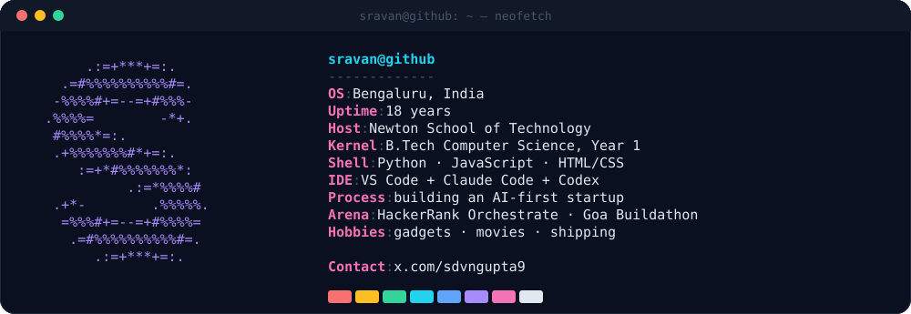

<p align="center">
  
</p>

<p align="center">
  
</p>

<p align="center">
  <a href="https://x.com/sdvngupta9"></a>
</p>

---

### `$ cat philosophy.txt`

> Ideas are cheap. Shipped is everything.
> I use AI agents as a force multiplier, so a first-year can build what used to take a team.

### `$ ls ./projects`

| | Project | What it does |
|:-:|---|---|
| 🕵️ | **[digital-detective](https://github.com/sravan793/digital-detective-8027)** | Python number-system converter, built as an 8-mission Git & Linux investigation |
| 🌐 | **[my-portfolio](https://github.com/sravan793/my-portfolio-)** | My personal corner of the internet |
| 🧱 | **[new-website](https://github.com/sravan793/new-website)** | A hand-built HTML site, zero frameworks |
| 🔒 | **stealth-startup** | AI-first product in the works. Watch this space |

### `$ tail -f build.log`

```diff
+ [2026-11] Started building in public
+ [2026-12] HackerRank Orchestrate, Bengaluru
+ [2027-01] Devfolio Goa Buildathon
+ [  next ] Ship v1 of the startup
```

### `$ ./collaborate.sh`

Building something ambitious, need a hackathon teammate, or want to talk AI and startups?
**DM me on [X](https://x.com/sdvngupta9).** I reply faster than my compiler.

<p align="right"><sub><code>exit 0</code></sub></p>
