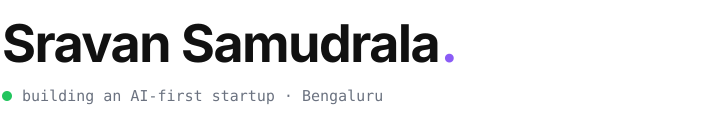

<picture>
  <source media="(prefers-color-scheme: dark)" srcset="./assets/name-dark.svg" />
  
</picture>

I build software with AI and turn ideas into products, fast. 
First-year CS at Newton School of Technology. Working on a startup.

&nbsp;

**Now** 
&nbsp;&nbsp;Building an AI-first product in stealth 
&nbsp;&nbsp;Exploring agent workflows with Claude Code and Codex

**Projects** 
&nbsp;&nbsp;[digital-detective](https://github.com/sravan793/digital-detective-8027) · number-system converter in Python 
&nbsp;&nbsp;[new-website](https://github.com/sravan793/new-website) · a hand-built site, no frameworks 
&nbsp;&nbsp;[my-portfolio](https://github.com/sravan793/my-portfolio-) · my corner of the internet

**Next up** 
&nbsp;&nbsp;HackerRank Orchestrate · Dec 2026 
&nbsp;&nbsp;Devfolio Goa Buildathon · Jan 2027

**Stack** 
&nbsp;&nbsp;Python · JavaScript · HTML/CSS · Git · Docker · Linux

&nbsp;

[X](https://x.com/sdvngupta9) &nbsp;·&nbsp; [GitHub](https://github.com/sravan793)
